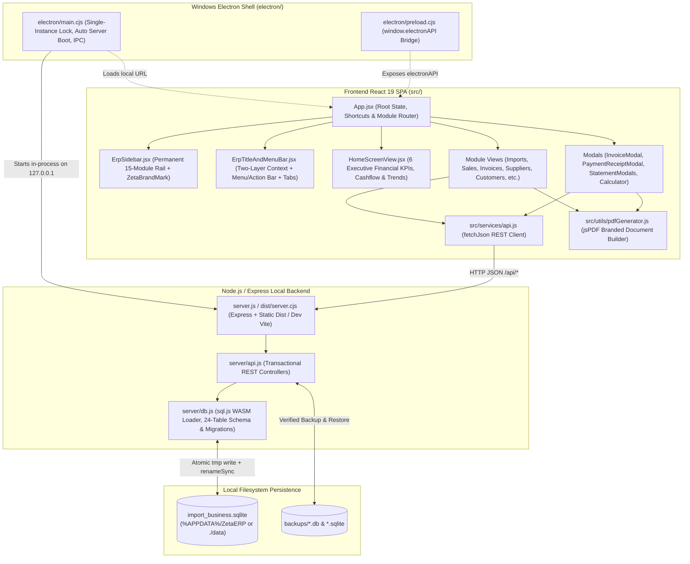

# Technical Architecture Document (`ARCHITECTURE.md`)
**System:** ZetaERP — Import Business Management System  
**Version:** `1.0.0`  
**Architecture Pattern:** Offline-First Full-Stack Local Desktop & Web ERP (Express + React 19 + `sql.js` SQLite + Electron Windows Wrapper)  
**Default Web/Dev Port:** `3000` (`http://0.0.0.0:3000` in Web/Dev; dynamic conflict-free `127.0.0.1` loopback port when packaged as a Windows `.exe`)

---

## 1. Verified Technology Stack & Dependency Versions

All packages and versions below match `/package.json` (100% pure JavaScript — zero TypeScript compiler overhead):

| Layer | Technology / Package | Version | Purpose in Codebase |
| :--- | :--- | :--- | :--- |
| **Frontend UI** | `react` / `react-dom` | `^19.0.1` | Single-Page Application (SPA) component tree, hooks, and workspace state |
| **Language** | JavaScript (`ESM` + `CJS`) | ES2024 | `.js` / `.jsx` across `src/` and `server/`; `.cjs` in `electron/` and `scripts/` |
| **Frontend Bundler** | `vite` / `@vitejs/plugin-react` | `^6.2.3` / `^5.0.4` | Production UI bundling (`dist/`) and dev-mode middleware inside Express |
| **Backend Bundler** | `esbuild` | `^0.25.0` | Bundles `server.js`, `express`, and `sql.js` into standalone `dist/server.cjs` |
| **Styling** | `tailwindcss` / `@tailwindcss/vite` | `^4.1.14` | Utility-first CSS imported via `@import "tailwindcss";` in `src/index.css` |
| **Icons** | `lucide-react` | `^0.546.0` | Crisp enterprise iconography across sidebar, headers, tables, and modals |
| **Charts & Analytics** | `recharts` | `^3.10.1` | Revenue vs. Expense trend charts and breakdown visualizations |
| **PDF Generation** | `jspdf` | `^4.2.1` | Client-side A4 PDF generation for invoices, money receipts, and Khata statements |
| **Backend Framework** | `express` | `^4.21.2` | Local REST API (`/api/*`) and static SPA host |
| **Database Engine** | `sql.js` | `^1.14.2` | WebAssembly SQLite engine (`sql-wasm.wasm`) with atomic file persistence |
| **Desktop Packaging** | `electron` / `electron-builder` | `^44.2.0` / `^26.15.3` | Windows desktop shell (`electron/main.cjs`) producing NSIS Setup & Portable `.exe` |
| **Automated Testing** | `vitest` / `@testing-library/react` / `jsdom` | `^5.0.5` / `^16.3.3` / `^30.1.3` | 50 unit, component, API, and SQLite database reliability tests (`npm test`) |

---

## 2. High-Level Architecture & Component Relationships



---

## 3. Project Directory Structure & Key Files

```text
/
├── .env.example                  # Environment variable template (no secrets)
├── electron-builder.json         # Windows x64 NSIS Setup & Portable .exe packaging config
├── index.html                    # SPA HTML entry point & OpenGraph/icon metadata
├── metadata.json                 # Application metadata manifest
├── package.json                  # Scripts, Electron main entry, and dependencies
├── server.js                     # Express API & dev/prod server entry point
├── vite.config.js                # Vite bundler & Vitest test runner configuration
├── scripts/
│   ├── build.cjs                 # Cross-platform Vite + esbuild + WASM + Windows .exe builder
│   ├── clean.cjs                 # Cross-platform directory cleanup (dist, dist-electron)
│   └── icon-data.cjs             # Embedded multi-size Windows .ico & .png ZetaERP icon binary data
├── electron/
│   ├── main.cjs                  # Electron main process (embedded server boot, dialogs, print IPC)
│   ├── preload.cjs               # ContextBridge exposing window.electronAPI (print, dialogs, window)
│   ├── icon.ico                  # Generated 4-frame (256/48/32/16px) Windows executable icon
│   └── icon.png                  # Generated 256x256 window icon
├── server/
│   ├── db.js                     # WASM binary loader, 24-table DDL, migrations, atomic disk persistence
│   └── api.js                    # Express router implementing all transactional /api/* endpoints
├── data/                         # Local dev/container fallback directory for SQLite DB & backups
│   ├── import_business.sqlite    # Active SQLite database file
│   └── backups/                  # Timestamped .db / .sqlite snapshots
└── src/
    ├── main.jsx                  # React 19 root mount (<App />)
    ├── App.jsx                   # Root shell, parallel data loader, tab router, keyboard shortcuts
    ├── index.css                 # Tailwind v4 import, slate design tokens, global table styles
    ├── services/
    │   └── api.js                # REST client methods for all /api/* routes
    ├── utils/
    │   ├── formatters.js         # PKR currency, weight, date/time, and Crore/Lac amount-to-words
    │   └── pdfGenerator.js       # Branded jsPDF builders (uses changeable settings.business_logo)
    ├── components/
    │   ├── ZetaBrandMark.jsx           # Fixed, non-changeable ZetaERP application logo & wordmark
    │   ├── ErpSidebar.jsx              # Permanent left sidebar listing all 15 modules + pinned Settings
    │   ├── ErpTitleAndMenuBar.jsx      # Two-layer logical header + open MDI workspace tabs
    │   ├── HomeScreenView.jsx          # Executive financial dashboard (Income, Expense, Profit, Khata, Stock)
    │   ├── ErpCalculatorModal.jsx      # Precision arithmetic & Import Landed Cost calculator modal
    │   ├── ErpAboutModal.jsx           # User manual, keyboard shortcuts, and ZetaERP system info
    │   ├── ImportsView.jsx             # Import consignments, clearing charges & landed cost per KG
    │   ├── SuppliersView.jsx           # Overseas suppliers & chronological Supplier Khata ledger
    │   ├── SupplierStatementModal.jsx  # Date-filtered supplier statement & branded print/PDF export
    │   ├── WarehousesView.jsx          # Godowns & port terminal locations
    │   ├── VehiclesView.jsx            # Company fleet & Scenario 2 commercial haulage trips
    │   ├── ProductsView.jsx            # Cargo SKU catalog & category management
    │   ├── InventoryView.jsx           # Stock valuation, movement history & physical audit adjustments
    │   ├── CustomersView.jsx           # Local buyers & chronological Customer Khata ledger
    │   ├── CustomerStatementModal.jsx  # Date-filtered customer statement & branded print/PDF export
    │   ├── SalesView.jsx               # Wholesale billing & POS dispatch workspace
    │   ├── InvoicesView.jsx            # Searchable commercial invoice register
    │   ├── InvoiceModal.jsx            # Branded A4 Commercial Invoice & 80mm Thermal Receipt preview
    │   ├── PaymentReceiptModal.jsx     # Official Money Receipt / Payment Voucher modal
    │   ├── ExpensesView.jsx            # Vehicle, Labour & Other daily expense vouchers
    │   ├── EmployeesView.jsx           # Personnel registry, batch attendance, advances & deductions
    │   ├── PayrollView.jsx             # Monthly payroll generator, salary payouts & daily labour wages
    │   ├── ReportsView.jsx             # P&L, Sales, Imports, Expenses, Stock & Payroll reports
    │   ├── BackupView.jsx              # SQLite snapshot vault, verified upload/restore & JSON export
    │   ├── SettingsView.jsx            # Business profile, changeable document logo & DB utilities
    │   └── SimpleFormDialog.jsx        # Reusable accessible modal form container
    └── test/                           # 7 Vitest suites (50 tests) covering UI, utils, API & SQLite DB
```

---

## 4. Application Entry Points & Execution Flows

### 4.1 Development Mode (`npm run dev`)
1. Runs `node server.js`.
2. `initializeDatabase()` (`server/db.js`) loads `sql-wasm.wasm` into memory, opens or creates `import_business.sqlite`, enables `PRAGMA foreign_keys = ON;`, runs `createSchema()` (24 tables + non-destructive `ALTER TABLE` migrations), seeds essential baseline settings/categories once (`system_initialized = '1'`), and atomically saves to disk.
3. `server.js` mounts `/api/health`, `/api` (`server/api.js`), JSON 404/error handlers, and dynamically imports `vite` in `middlewareMode: true` (`appType: 'spa'`).
4. Listens on `http://0.0.0.0:3000`.

### 4.2 Production Web / Server Build (`npm run build:web` & `npm start`)
1. `scripts/build.cjs` ensures `electron/icon.ico` & `electron/icon.png` exist, runs `vite build` (`dist/`), bundles `server.js` + `express` + `sql.js` into standalone `dist/server.cjs` (`--external:vite`), and copies `sql-wasm.wasm` to `dist/sql-wasm.wasm`.
2. `NODE_ENV=production node dist/server.cjs` (or `npm start`) serves compiled static assets from `dist/` alongside `/api/*`.

### 4.3 Windows Desktop `.exe` Packaging & Runtime (`npm run build` on Windows or `npm run build:exe`)
1. On Windows (`process.platform === 'win32'`), running `npm run build` (or `npm run build:exe` / `npm run pack:win`) compiles the frontend and standalone server bundle, then automatically invokes `electron-builder --win --config electron-builder.json`.
2. Outputs two Windows x64 executables in `dist-electron/` without requiring Visual Studio C++ Build Tools (`npmRebuild: false`) or code-signing certificates (`signExecutable: false`):
   - `ZetaERP-Setup-1.0.0.exe` (NSIS installer with custom directory picker and Desktop/Start Menu shortcuts).
   - `ZetaERP-Portable-1.0.0.exe` (single-file zero-install portable executable).
3. At runtime, `electron/main.cjs` acquires a single-instance lock, sets `ZETA_DATA_DIR` to `%APPDATA%\ZetaERP`, boots `dist/server.cjs` in-process on an OS-assigned free loopback port (`127.0.0.1`), and opens `BrowserWindow` directly to that local URL.

---

## 5. Dual-Logo Branding Architecture

1. **Permanent Application Logo (`ZetaBrandMark.jsx`):**
   - Renders the fixed ZetaERP emblem and **ZetaERP** brand identity in the sidebar top header, window icon (`electron/icon.ico`), and About dialog. Cannot be overwritten by user settings.
2. **Changeable Business Document Logo (`settings.business_logo` in `SettingsView.jsx`):**
   - Uploaded by the business owner in **System Settings** (stored locally as a Data URI in the `settings` table) alongside `business_name`, `address`, `phone`, `ntn_number`, `strn_number`, and `invoice_footer`.
   - Rendered exclusively on business printouts and exported PDFs: Commercial Invoices, Thermal Receipts, Money Receipts/Payment Vouchers, Customer/Supplier Khata Statements, and Financial Reports.

---

## 6. Backend API Surface (`server/api.js`)

All `/api/*` routes return clean JSON `{ success: boolean, data?: any, message?: string, error?: string }` (with dedicated unknown `/api/*` 404 and malformed-JSON 400 handlers):

| Domain | Endpoints | Core Responsibilities |
| :--- | :--- | :--- |
| **Health & Dashboard** | `GET /api/health`, `GET /api/dashboard/stats` | SQLite status, period-filtered revenue/expenses/COGS/net profit, receivables, payables, stock value, 6-month trend |
| **Products & Categories** | `GET/POST /api/products`, `PUT/DELETE /api/products/:id`, `GET/POST /api/categories`, `DELETE /api/categories/:id` | SKU master catalog, initial stock logging, soft-deactivation when referenced in imports/sales |
| **Warehouses** | `GET/POST /api/warehouses`, `PUT/DELETE /api/warehouses/:id` | Godowns & port yards with linked import/sale counts and referential soft-deactivation |
| **Suppliers & Khata** | `GET/POST /api/suppliers`, `PUT/DELETE /api/suppliers/:id`, `GET /api/suppliers/:id/ledger`, `GET /api/suppliers/:id/statement`, `GET /api/suppliers/:id/audit-logs` | Overseas vendor directory, opening-balance delta adjustment, chronological running-balance Khata |
| **Customers & Khata** | `GET/POST /api/customers`, `PUT/DELETE /api/customers/:id`, `GET /api/customers/:id/ledger`, `GET /api/customers/:id/statement`, `GET /api/customers/:id/audit-logs` | Local buyer directory, transactional opening-balance delta adjustment, chronological Khata |
| **Imports** | `GET/POST /api/imports`, `GET /api/imports/:id` | Atomic multi-item import creation, stock increase, supplier payable update, hired freight & clearing expenses |
| **Inventory** | `GET /api/inventory`, `GET /api/inventory/transactions`, `POST /api/inventory/adjustment` | Purchase/retail stock valuation, movement history, physical audit stock adjustments |
| **Sales & Invoices** | `GET/POST /api/sales`, `GET /api/sales/:id`, `GET /api/invoices/:invoiceNumber` | Negative-stock guard, atomic stock deduction, customer receivable update, printable invoice payload |
| **Expenses** | `GET/POST /api/expenses`, `DELETE /api/expenses/:id`, `GET/POST /api/expense-categories` | `VEHICLE`, `LABOUR`, and `OTHER` vouchers synchronized with `payments` (`EXPENSE_PAYMENT`) |
| **Vehicles & Trips** | `GET/POST /api/vehicles`, `PUT/DELETE /api/vehicles/:id`, `GET/POST /api/vehicle-trips`, `POST /api/vehicle-trips/:id/receive-payment`, `DELETE /api/vehicle-trips/:id` | Fleet cost/revenue tracking and Scenario 2 commercial haulage trips |
| **HR & Payroll** | `GET/POST /api/employees`, `PUT /api/employees/:id`, `GET /api/attendance`, `POST /api/attendance/batch`, `GET/POST /api/salary-advances`, `GET/POST /api/salary-deductions`, `GET /api/payroll`, `POST /api/payroll/generate`, `POST /api/payroll/pay`, `GET/POST /api/daily-labour-payments` | Staff directory, batch attendance upsert, pro-rated monthly payroll generation, advance recovery, daily labour gangs |
| **Payments & Vouchers** | `GET /api/payments`, `POST /api/payments/customer`, `POST /api/payments/supplier`, `PUT /api/payments/:id`, `POST /api/payments/:id/void`, `GET /api/payments/:id/receipt` | Party receipts/payouts, void reversal with invoice & balance restoration, `audit_logs` tracking |
| **Reports** | `GET /api/reports` | Supports `profit` (`profit_loss`), `sales` (`sales_summary`, `product_sales`), `imports`, `expenses` (`expenses_summary`), `payroll`, `stock_valuation`, and `receivables_payables` |
| **Backup & Export** | `GET /api/backup/info`, `POST /api/backup/create`, `POST /api/backup/restore`, `GET /api/backup/download-current`, `GET /api/backup/download/:filename`, `POST /api/backup/upload`, `DELETE /api/backup/:filename`, `GET /api/backup/export-json` | Magic-header (`SQLite format 3`) validation, path-traversal protection, `Safety_PreRestore` checkpoints, and full 24-table JSON export |
| **Settings** | `GET/PUT /api/settings`, `POST /api/settings/reset-database`, `POST /api/settings/seed-default-master`, `POST /api/settings/seed-mock-data` | Company profile & changeable business logo, inventory rules, persistent clean reset, master defaults, and sample dataset seeding |

---

## 7. SQLite Database Reliability & Persistence (`server/db.js`)

The active SQLite schema defines **24 tables**:
`categories`, `products`, `warehouses`, `suppliers`, `customers`, `imports`, `import_items`, `sales`, `sale_items`, `inventory_transactions`, `vehicles`, `vehicle_trips`, `expense_categories`, `expenses`, `employees`, `attendance`, `salary_advances`, `salary_deductions`, `salary_payroll`, `salary_payments`, `daily_labour_payments`, `payments`, `audit_logs`, and `settings`.

Key reliability guarantees:
1. **Atomic File Writes (`saveDbToDisk`):** Exports the binary SQLite image to `<dbFilePath>.tmp.<pid>.<timestamp>` first, then executes atomic `fs.renameSync` onto `import_business.sqlite` so an interrupted write never corrupts the existing database.
2. **Foreign Key & Transaction Safety:** Enforces `PRAGMA foreign_keys = ON;`. Multi-table operations execute inside `BEGIN TRANSACTION` / `COMMIT` / `ROLLBACK`, and database reset/seed routines delete child tables before parent tables in strict topological order.
3. **Persistent Clean Resets:** Uses `settings.system_initialized = '1'` so resetting the database to a clean state remains clean across restarts until the user explicitly seeds data or adds records.
4. **Multi-Environment WASM Resolution:** Automatically loads `sql-wasm.wasm` via `fs.readFileSync` from `ZETA_WASM_PATH`, `app.asar.unpacked/dist/sql-wasm.wasm`, `dist/sql-wasm.wasm`, or `node_modules/sql.js/dist/sql-wasm.wasm`.

