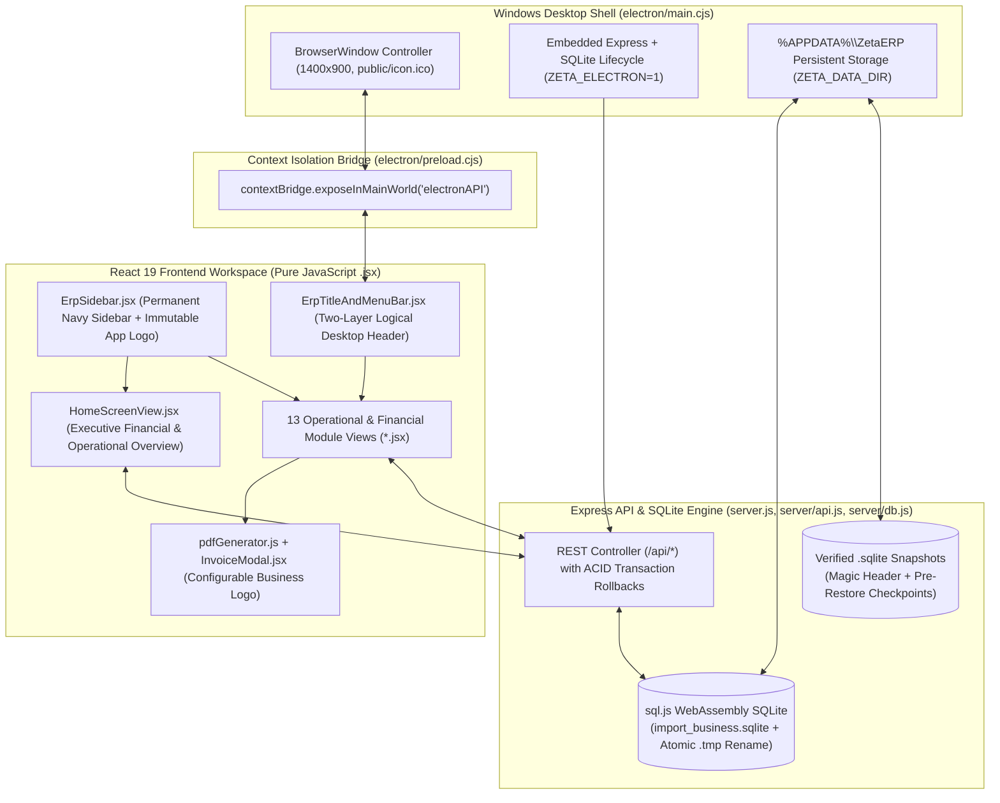

# Architectural Specification, Module Breakdown & Database Reference (`ERP_SPECIFICATION.md`)
## ZetaERP — Offline-First Import, Wholesale & Fleet Desktop ERP (Electron + React + Express + SQLite, 100% JavaScript)

---

## High-Level Desktop & Web System Architecture



---

## 1. Project Objectives

### 1.1 General Objective
Provide a reliable, crash-safe, **100% offline-capable Windows desktop (`.exe`) and local web ERP application** built entirely in **pure JavaScript** (`Electron`, `React 19`, `Express`, and `sql.js` SQLite). ZetaERP centralizes international cargo imports, multi-warehouse stock control, commercial billing, overseas supplier & local customer Khata ledgers, fleet haulage trips, employee payroll, and executive financial reporting.

### 1.2 Specific Objectives
1. **End-to-End Import & Landed Cost Tracking:** Track multi-SKU international consignments (`IMP-xxxxxx`), aggregating purchase value, customs/clearing charges, unloading labour, and hired freight into an exact **Landed Cost** (`total_cost`) and **Landed Cost per KG**.
2. **Overseas Supplier & Local Customer Khata Control:** Maintain chronological running-balance ledgers for suppliers (payables) and wholesale customers (receivables), supporting partial settlements, bank transfers/cheques, payment voiding with automatic balance reversal, and printable vouchers/statements.
3. **Multi-Godown Warehouse & SKU Stock Accuracy:** Track real-time SKU stock (`products.current_stock`), stock valuation (purchase vs. retail), low-stock alerts (`min_stock_level`), cumulative multi-row over-selling prevention, and immutable movement histories (`IMPORT`, `SALE`, `ADJUSTMENT`, `INITIAL`).
4. **Fleet & Commercial Haulage Management:** Manage company-owned trucks alongside third-party carriers—tracking Bilty numbers, fuel/maintenance expenses, and commercial haulage revenue/profit (`vehicle_trips`).
5. **Workforce Attendance & Automated Monthly Payroll:** Link daily attendance (`Present`, `Absent`, `Half Day`, `Leave`, `Overtime Hours`), salary advances, and deductions directly into monthly payroll sheet generation (`salary_payroll`), disbursements (`salary_payments`), and daily labour gang payouts (`daily_labour_payments`).
6. **Strict Dual-Logo Branding & Document Generation:** Keep the **ZetaERP App Logo** (`ZetaBrandMark.jsx`) permanently locked as the software identity while allowing businesses to upload their own **Business Logo** (`settings.business_logo`) in Settings to brand A4 Commercial Invoices, 80mm Thermal Receipts, Khata Statements, and PDF Reports.
7. **Crash-Safe Persistence & One-Command Windows `.exe` Packaging:** Protect local financial data via atomic `.tmp` + `fs.renameSync` disk flushes, path-traversal hardened backup endpoints, `SQLite format 3` binary header verification, and one-command Windows NSIS + Portable `.exe` compilation.

---

## 2. Runtime, Packaging & Storage Constraints

### 2.1 Offline-First Pure JavaScript Execution
- **100% JavaScript:** Every frontend component (`.jsx`), service/utility (`.js`), backend route (`server.js`, `server/api.js`, `server/db.js`), Electron process (`electron/*.cjs`), and build script (`scripts/*.cjs`) runs in standard JavaScript with zero TypeScript compilation overhead.
- **Zero Cloud Dependency:** All queries, charts (`recharts`), and PDF documents (`jspdf`) execute locally offline.

### 2.2 Windows `.exe` Packaging (`electron-builder.json` & `scripts/build.cjs`)
- **Build Commands:**
  - `npm install` — Installs dependencies.
  - `npm run build` — Generates `public/icon.ico` (4-layer `256x256`, `64x64`, `32x32`, `16x16` icon), bundles the Vite frontend into `dist/`, and automatically invokes `electron-builder --win` when run on Windows (or when `--win` is passed).
  - `npm run build:exe` — Explicit command (`node scripts/build.cjs --win`) producing Windows executables in `dist-electron/`:
    1. **`ZetaERP-Setup-1.0.0.exe`** — NSIS installer (`oneClick: false`, custom directory selection, Desktop & Start Menu shortcuts, `deleteAppDataOnUninstall: false`).
    2. **`ZetaERP-Portable-1.0.0.exe`** — Standalone zero-install portable Windows executable.
- **WebAssembly Unpacking:** `node_modules/sql.js/dist/sql-wasm.wasm` is listed under `asarUnpack` in `electron-builder.json` and dynamically resolved via `locateFile` in `server/db.js` (`app.asar.unpacked`).
- **Persistent Data Directory:**
  - **Windows `.exe` Mode:** `electron/main.cjs` sets `process.env.ZETA_DATA_DIR = app.getPath('userData')` (`%APPDATA%\ZetaERP`), storing `import_business.sqlite` and `backups/` safely outside the installation folder.
  - **Web / Local Dev Mode (`npm run dev`):** Stores `data/import_business.sqlite` and `data/backups/` inside the workspace directory on port `3000`.

### 2.3 Dual-Logo Architecture
- **App Logo (Immutable):** `src/components/ZetaBrandMark.jsx` renders `/assets/aistudio/Gemini_Generated_Image_d80toed80toed80t_6a689eba.jpeg` in `ErpSidebar.jsx`, `ErpAboutModal.jsx`, `index.html`, and `public/icon.ico`. Cannot be altered by end users.
- **Business Logo (Configurable):** Stored in `settings` (`key = 'business_logo'`) via `SettingsView.jsx` (`Settings -> Branding`). Injected onto A4 Commercial Invoices, 80mm Thermal Receipts, Customer/Supplier Khata Statements, and PDF Reports via `src/utils/pdfGenerator.js` and `src/components/InvoiceModal.jsx`.

---

## 3. Desktop Shell & Complete Component Breakdown (`src/components/*.jsx`)

### Desktop Shell & Global Modals
1. **`ErpSidebar.jsx`:** Permanent left navigation sidebar (`w-56`, `#0f172a` slate-navy) featuring the immutable `ZetaBrandMark` header, 5 logical navigation groups (`Overview`, `Procurement & Stock`, `Sales & Parties`, `Operations & HR`, `Finance & System`), and business footer.
2. **`ErpTitleAndMenuBar.jsx`:** Two-layer logical desktop header:
   - **Layer 1 (Top Application Bar):** Active module title + subtitle on the left; classic hover/click desktop menus (`File`, `Edit`, `View`, `Modules`, `Tools`, `Help`) in the center/right; `Sync`, `Fullscreen`, Electron IPC window controls (`Minimize`, `Maximize`, `Close`), and `User` profile menu on the far right.
   - **Layer 2 (Secondary Action & Workspace Bar):** Quick-action buttons (`+ Import`, `+ New Sale`, `+ Expense`) and `Calculator` trigger on the left; dynamic closable workspace tabs on the right.
3. **`HomeScreenView.jsx`:** Executive financial & operational overview dashboard displaying live KPI cards (Revenue, Gross/Net Profit, Receivables, Payables, Stock Value), Cash Flow & Profit Trend charts, Low-Stock alerts, Fleet Utilization, and Recent Transactions/Audit activity (with zero redundant module launcher grid).
4. **Shared Modals & Utilities:**
   - `ZetaBrandMark.jsx` (Official immutable ZetaERP emblem)
   - `ErpCalculatorModal.jsx` (Built-in desktop arithmetic calculator)
   - `ErpAboutModal.jsx` (Software version, architecture, and licensing dialog)
   - `SimpleFormDialog.jsx` (Reusable accessible modal wrapper)

---

### Operational & Financial Modules (13 Modules + Inventory Valuation View)

| # | Module | Primary Component(s) | Core Capabilities |
| :- | :--- | :--- | :--- |
| **1** | **Import Management** | `ImportsView.jsx` | Multi-SKU shipment entry (`IMP-xxxxxx`), company vs. 3rd-party transport, inline clearing expenses, stock increment, supplier payable update, and landed cost per KG breakdown. |
| **2** | **Suppliers (Khata)** | `SuppliersView.jsx`, `SupplierStatementModal.jsx` | Overseas supplier directory (`SUP-xxxx`), chronological payable ledger, `PAID`/`RECEIVED` settlements, payment voiding, opening balance delta sync, and PDF statements. |
| **3** | **Warehouses** | `WarehousesView.jsx` | Godown & terminal registry (`WH-xxxx`), capacity & manager details, inbound/outbound activity tracking, and deletion protection when linked to stock records. |
| **4** | **Vehicles & Fleet** | `VehiclesView.jsx` | Company fleet registry, per-vehicle fuel/maintenance summaries, and commercial haulage trip ledger (`TRP-xxxxxx`) tracking freight income, expenses, and net trip profit. |
| **5** | **Products & Inventory** | `ProductsView.jsx`, `InventoryView.jsx` | SKU catalog (`PRD-xxxx`), category manager, default purchase/selling rates, stock valuation matrix, movement history (`inventory_transactions`), and manual stock adjustments. |
| **6** | **Customers (Khata)** | `CustomersView.jsx`, `CustomerStatementModal.jsx`, `PaymentReceiptModal.jsx` | Wholesale buyer directory (`CUST-xxxx`), chronological receivable ledger, official money receipts (with amount in words), payment voiding, and PDF statements. |
| **7** | **Sales & Invoices** | `SalesView.jsx`, `InvoicesView.jsx`, `InvoiceModal.jsx` | Multi-item wholesale billing (`INV-xxxxxx`), cumulative cart SKU stock validation, discount & partial payment handling, A4 Commercial Invoice, and 80mm Thermal Receipt printing. |
| **8** | **Expenses** | `ExpensesView.jsx` | Daily operational expense vouchers across `VEHICLE`, `LABOUR`, and `OTHER` groups with custom categories and optional links to imports, vehicles, or employees. |
| **9** | **Employees & Attendance** | `EmployeesView.jsx` | Personnel directory (`EMP-xxxx`), batch daily attendance sheet (`Present`, `Absent`, `Half Day`, `Leave`, `Overtime`), salary advances, and salary deductions. |
| **10** | **Payroll & Salaries** | `PayrollView.jsx` | Automated monthly payroll generation (`YYYY-MM` with duplicate-run protection), salary disbursement tracking (`salary_payments`), advance recovery, and daily labour gang payouts. |
| **11** | **Reports & Analytics** | `ReportsView.jsx` | Date-filtered Profit & Loss (P&L) statement, Sales report, Import landed-cost report, Expense breakdown, and Payroll summary with Recharts visualizations and PDF export. |
| **12** | **Settings & Branding** | `SettingsView.jsx` | Configurable company profile, **Business Logo** upload (`settings.business_logo`) for printed documents, invoice terms, stock rules (`allow_negative_stock`), and Clean/Demo DB reset tools. |
| **13** | **Backup & Restore** | `BackupView.jsx` | One-click `.sqlite` snapshots, 24-table full JSON export, path-traversal protected download/delete, `SQLite format 3` verified restore, and automatic `Safety_PreRestore` checkpoints. |

---

## 4. Automated Test Suite (`src/test/`)

All **50 tests across 7 test files** execute via `npm test` (Vitest + React Testing Library + Supertest):
1. `src/test/utils-and-api.test.js` — Currency/weight/date formatters, amount-in-words PKR converter, PDF generator helpers, and client API wrapper methods.
2. `src/test/shell-and-modals.test.jsx` — `ErpSidebar`, two-layer `ErpTitleAndMenuBar`, `ZetaBrandMark` immutability, `InvoiceModal` (Business Logo rendering), `PaymentReceiptModal`, `CustomerStatementModal`, `SupplierStatementModal`, `ErpCalculatorModal`, and `ErpAboutModal`.
3. `src/test/home-and-reports.test.jsx` — Executive `HomeScreenView` KPI/chart rendering, `ReportsView` P&L/tab switching, `SettingsView` Business Logo upload & configuration, and `BackupView` snapshot controls.
4. `src/test/catalog-and-trade.test.jsx` — `ProductsView`, `InventoryView`, `WarehousesView`, `ImportsView`, `SalesView`, and `InvoicesView`.
5. `src/test/ledgers-and-operations.test.jsx` — `SuppliersView`, `CustomersView`, `ExpensesView`, `VehiclesView`, `EmployeesView`, and `PayrollView`.
6. `src/test/app-integration.test.jsx` — Full `<App />` workspace tab switching, sidebar navigation, quick actions, and state synchronization.
7. `src/test/server-and-db.test.js` — Real SQLite + Express API integration tests verifying schema creation, ACID rollbacks, cumulative multi-row SKU stock checks, import/sale deletion balance reversals, Khata payment voiding, path-traversal rejection, corrupt-file restore rejection, and 24-table JSON backup export.

---

## 5. Exact SQLite Database Schema (`server/db.js`)

Below is the exact production SQLite schema initialized by `createSchema(db)` in `server/db.js` (24 active operational/financial tables + `system_logs` diagnostic table):

```sql
PRAGMA foreign_keys = ON;

-- 1. Categories
CREATE TABLE IF NOT EXISTS categories (
  id INTEGER PRIMARY KEY AUTOINCREMENT,
  name TEXT NOT NULL UNIQUE,
  description TEXT,
  created_at DATETIME DEFAULT CURRENT_TIMESTAMP
);

-- 2. Warehouses / Godowns / Port Terminals
CREATE TABLE IF NOT EXISTS warehouses (
  id INTEGER PRIMARY KEY AUTOINCREMENT,
  name TEXT NOT NULL UNIQUE,
  code TEXT UNIQUE,
  location TEXT,
  capacity TEXT,
  manager_name TEXT,
  phone TEXT,
  is_active INTEGER NOT NULL DEFAULT 1 CHECK (is_active IN (0, 1)),
  created_at DATETIME DEFAULT CURRENT_TIMESTAMP
);
CREATE INDEX IF NOT EXISTS idx_warehouses_name ON warehouses(name);

-- 3. Vehicles
CREATE TABLE IF NOT EXISTS vehicles (
  id INTEGER PRIMARY KEY AUTOINCREMENT,
  vehicle_number TEXT NOT NULL UNIQUE,
  vehicle_type TEXT NOT NULL,
  driver_name TEXT,
  driver_phone TEXT,
  notes TEXT,
  is_active INTEGER NOT NULL DEFAULT 1 CHECK (is_active IN (0, 1)),
  created_at DATETIME DEFAULT CURRENT_TIMESTAMP
);

-- 4. Employees & Labour
CREATE TABLE IF NOT EXISTS employees (
  id INTEGER PRIMARY KEY AUTOINCREMENT,
  employee_code TEXT UNIQUE,
  name TEXT NOT NULL,
  phone TEXT,
  address TEXT,
  role TEXT NOT NULL,
  joining_date DATE NOT NULL,
  employment_type TEXT NOT NULL CHECK (employment_type IN ('Permanent', 'Daily Labour', 'Temporary', 'Contract')),
  salary_type TEXT NOT NULL CHECK (salary_type IN ('Monthly', 'Daily', 'Job-based')),
  monthly_salary REAL NOT NULL DEFAULT 0 CHECK (monthly_salary >= 0),
  daily_wage REAL NOT NULL DEFAULT 0 CHECK (daily_wage >= 0),
  overtime_rate REAL NOT NULL DEFAULT 0 CHECK (overtime_rate >= 0),
  is_active INTEGER NOT NULL DEFAULT 1 CHECK (is_active IN (0, 1)),
  notes TEXT,
  created_at DATETIME DEFAULT CURRENT_TIMESTAMP
);
CREATE INDEX IF NOT EXISTS idx_emp_name ON employees(name);

-- 5. Expense Categories
CREATE TABLE IF NOT EXISTS expense_categories (
  id INTEGER PRIMARY KEY AUTOINCREMENT,
  name TEXT NOT NULL UNIQUE,
  group_type TEXT NOT NULL CHECK (group_type IN ('VEHICLE', 'LABOUR', 'OTHER')),
  is_default INTEGER NOT NULL DEFAULT 1,
  created_at DATETIME DEFAULT CURRENT_TIMESTAMP
);

-- 6. Products
CREATE TABLE IF NOT EXISTS products (
  id INTEGER PRIMARY KEY AUTOINCREMENT,
  product_code TEXT UNIQUE,
  name TEXT NOT NULL,
  category_id INTEGER,
  description TEXT,
  unit TEXT NOT NULL DEFAULT 'KG' CHECK (unit IN ('KG', 'Gram', 'Ton', 'Box', 'Bale', 'Bag', 'Piece')),
  default_purchase_rate REAL NOT NULL DEFAULT 0 CHECK (default_purchase_rate >= 0),
  default_selling_rate REAL NOT NULL DEFAULT 0 CHECK (default_selling_rate >= 0),
  current_stock REAL NOT NULL DEFAULT 0,
  min_stock_level REAL NOT NULL DEFAULT 50,
  is_active INTEGER NOT NULL DEFAULT 1 CHECK (is_active IN (0, 1)),
  created_at DATETIME DEFAULT CURRENT_TIMESTAMP,
  updated_at DATETIME DEFAULT CURRENT_TIMESTAMP,
  FOREIGN KEY (category_id) REFERENCES categories (id) ON DELETE SET NULL
);
CREATE INDEX IF NOT EXISTS idx_products_name ON products(name);
CREATE INDEX IF NOT EXISTS idx_products_stock ON products(current_stock);

-- 7. Suppliers (Import Vendors)
CREATE TABLE IF NOT EXISTS suppliers (
  id INTEGER PRIMARY KEY AUTOINCREMENT,
  supplier_code TEXT UNIQUE,
  name TEXT NOT NULL,
  contact_person TEXT,
  phone TEXT,
  address TEXT,
  opening_balance REAL NOT NULL DEFAULT 0,
  current_balance REAL NOT NULL DEFAULT 0,
  notes TEXT,
  is_active INTEGER NOT NULL DEFAULT 1 CHECK (is_active IN (0, 1)),
  created_at DATETIME DEFAULT CURRENT_TIMESTAMP
);
CREATE INDEX IF NOT EXISTS idx_suppliers_name ON suppliers(name);

-- 8. Customers (Wholesale Accounts)
CREATE TABLE IF NOT EXISTS customers (
  id INTEGER PRIMARY KEY AUTOINCREMENT,
  customer_code TEXT UNIQUE,
  name TEXT NOT NULL,
  phone TEXT,
  address TEXT,
  opening_balance REAL NOT NULL DEFAULT 0,
  current_balance REAL NOT NULL DEFAULT 0,
  notes TEXT,
  is_active INTEGER NOT NULL DEFAULT 1 CHECK (is_active IN (0, 1)),
  created_at DATETIME DEFAULT CURRENT_TIMESTAMP
);
CREATE INDEX IF NOT EXISTS idx_customers_name ON customers(name);

-- 9. Imports / Shipments
CREATE TABLE IF NOT EXISTS imports (
  id INTEGER PRIMARY KEY AUTOINCREMENT,
  import_number TEXT NOT NULL UNIQUE,
  import_date DATE NOT NULL,
  supplier_id INTEGER NOT NULL,
  warehouse_id INTEGER,
  warehouse_name TEXT,
  transport_type TEXT DEFAULT 'COMPANY',
  vehicle_id INTEGER,
  vehicle_number TEXT,
  driver_name TEXT,
  driver_phone TEXT,
  transporter_name TEXT,
  bilty_number TEXT,
  hired_freight_cost REAL DEFAULT 0,
  total_weight REAL NOT NULL DEFAULT 0 CHECK (total_weight >= 0),
  total_purchase_amount REAL NOT NULL DEFAULT 0 CHECK (total_purchase_amount >= 0),
  related_expenses REAL NOT NULL DEFAULT 0 CHECK (related_expenses >= 0),
  total_cost REAL NOT NULL DEFAULT 0 CHECK (total_cost >= 0),
  notes TEXT,
  created_at DATETIME DEFAULT CURRENT_TIMESTAMP,
  FOREIGN KEY (supplier_id) REFERENCES suppliers (id),
  FOREIGN KEY (warehouse_id) REFERENCES warehouses (id) ON DELETE SET NULL,
  FOREIGN KEY (vehicle_id) REFERENCES vehicles (id) ON DELETE SET NULL
);
CREATE INDEX IF NOT EXISTS idx_imports_date ON imports(import_date);
CREATE INDEX IF NOT EXISTS idx_imports_supplier ON imports(supplier_id);

-- 10. Import Line Items
CREATE TABLE IF NOT EXISTS import_items (
  id INTEGER PRIMARY KEY AUTOINCREMENT,
  import_id INTEGER NOT NULL,
  product_id INTEGER NOT NULL,
  weight REAL NOT NULL CHECK (weight > 0),
  unit TEXT NOT NULL DEFAULT 'KG',
  rate_per_kg REAL NOT NULL CHECK (rate_per_kg >= 0),
  purchase_amount REAL NOT NULL CHECK (purchase_amount >= 0),
  created_at DATETIME DEFAULT CURRENT_TIMESTAMP,
  FOREIGN KEY (import_id) REFERENCES imports (id) ON DELETE CASCADE,
  FOREIGN KEY (product_id) REFERENCES products (id)
);

-- 11. Sales / Commercial Invoices
CREATE TABLE IF NOT EXISTS sales (
  id INTEGER PRIMARY KEY AUTOINCREMENT,
  invoice_number TEXT NOT NULL UNIQUE,
  sale_date DATE NOT NULL,
  customer_id INTEGER NOT NULL,
  warehouse_id INTEGER,
  warehouse_name TEXT,
  transport_type TEXT DEFAULT 'NONE',
  vehicle_id INTEGER,
  vehicle_number TEXT,
  driver_name TEXT,
  driver_phone TEXT,
  transporter_name TEXT,
  bilty_number TEXT,
  hired_freight_cost REAL DEFAULT 0,
  total_weight REAL NOT NULL DEFAULT 0 CHECK (total_weight >= 0),
  subtotal REAL NOT NULL DEFAULT 0 CHECK (subtotal >= 0),
  discount REAL NOT NULL DEFAULT 0 CHECK (discount >= 0),
  grand_total REAL NOT NULL DEFAULT 0 CHECK (grand_total >= 0),
  paid_amount REAL NOT NULL DEFAULT 0 CHECK (paid_amount >= 0),
  remaining_amount REAL NOT NULL DEFAULT 0,
  payment_status TEXT NOT NULL DEFAULT 'Unpaid' CHECK (payment_status IN ('Paid', 'Partially Paid', 'Unpaid')),
  notes TEXT,
  created_at DATETIME DEFAULT CURRENT_TIMESTAMP,
  FOREIGN KEY (customer_id) REFERENCES customers (id),
  FOREIGN KEY (warehouse_id) REFERENCES warehouses (id) ON DELETE SET NULL,
  FOREIGN KEY (vehicle_id) REFERENCES vehicles (id) ON DELETE SET NULL
);
CREATE INDEX IF NOT EXISTS idx_sales_date ON sales(sale_date);
CREATE INDEX IF NOT EXISTS idx_sales_customer ON sales(customer_id);

-- 12. Sale Line Items
CREATE TABLE IF NOT EXISTS sale_items (
  id INTEGER PRIMARY KEY AUTOINCREMENT,
  sale_id INTEGER NOT NULL,
  product_id INTEGER NOT NULL,
  weight REAL NOT NULL CHECK (weight > 0),
  unit TEXT NOT NULL DEFAULT 'KG',
  rate_per_kg REAL NOT NULL CHECK (rate_per_kg >= 0),
  amount REAL NOT NULL CHECK (amount >= 0),
  created_at DATETIME DEFAULT CURRENT_TIMESTAMP,
  FOREIGN KEY (sale_id) REFERENCES sales (id) ON DELETE CASCADE,
  FOREIGN KEY (product_id) REFERENCES products (id)
);

-- 13. Inventory Transaction History
CREATE TABLE IF NOT EXISTS inventory_transactions (
  id INTEGER PRIMARY KEY AUTOINCREMENT,
  product_id INTEGER NOT NULL,
  warehouse_id INTEGER,
  transaction_date DATETIME NOT NULL DEFAULT CURRENT_TIMESTAMP,
  transaction_type TEXT NOT NULL CHECK (transaction_type IN ('IMPORT', 'SALE', 'ADJUSTMENT', 'INITIAL')),
  quantity_weight REAL NOT NULL,
  reference_id TEXT,
  reference_type TEXT,
  previous_stock REAL NOT NULL,
  new_stock REAL NOT NULL,
  notes TEXT,
  created_at DATETIME DEFAULT CURRENT_TIMESTAMP,
  FOREIGN KEY (product_id) REFERENCES products (id),
  FOREIGN KEY (warehouse_id) REFERENCES warehouses (id) ON DELETE SET NULL
);
CREATE INDEX IF NOT EXISTS idx_inv_product ON inventory_transactions(product_id);
CREATE INDEX IF NOT EXISTS idx_inv_date ON inventory_transactions(transaction_date);

-- 14. Operational Expenses
CREATE TABLE IF NOT EXISTS expenses (
  id INTEGER PRIMARY KEY AUTOINCREMENT,
  expense_date DATE NOT NULL,
  category TEXT NOT NULL,
  group_type TEXT NOT NULL CHECK (group_type IN ('VEHICLE', 'LABOUR', 'OTHER')),
  description TEXT,
  amount REAL NOT NULL CHECK (amount > 0),
  related_import_id INTEGER,
  vehicle_id INTEGER,
  employee_id INTEGER,
  payment_method TEXT NOT NULL DEFAULT 'Cash' CHECK (payment_method IN ('Cash', 'Bank Transfer', 'Other')),
  notes TEXT,
  created_at DATETIME DEFAULT CURRENT_TIMESTAMP,
  FOREIGN KEY (related_import_id) REFERENCES imports (id) ON DELETE SET NULL,
  FOREIGN KEY (vehicle_id) REFERENCES vehicles (id) ON DELETE SET NULL,
  FOREIGN KEY (employee_id) REFERENCES employees (id) ON DELETE SET NULL
);
CREATE INDEX IF NOT EXISTS idx_expenses_date ON expenses(expense_date);
CREATE INDEX IF NOT EXISTS idx_expenses_group ON expenses(group_type);

-- 15. Daily Attendance
CREATE TABLE IF NOT EXISTS attendance (
  id INTEGER PRIMARY KEY AUTOINCREMENT,
  employee_id INTEGER NOT NULL,
  date DATE NOT NULL,
  status TEXT NOT NULL CHECK (status IN ('Present', 'Absent', 'Leave', 'Half Day')),
  overtime_hours REAL NOT NULL DEFAULT 0 CHECK (overtime_hours >= 0),
  notes TEXT,
  created_at DATETIME DEFAULT CURRENT_TIMESTAMP,
  UNIQUE (employee_id, date),
  FOREIGN KEY (employee_id) REFERENCES employees (id) ON DELETE CASCADE
);
CREATE INDEX IF NOT EXISTS idx_attendance_date ON attendance(date);

-- 16. Salary Advances
CREATE TABLE IF NOT EXISTS salary_advances (
  id INTEGER PRIMARY KEY AUTOINCREMENT,
  employee_id INTEGER NOT NULL,
  advance_date DATE NOT NULL,
  amount REAL NOT NULL CHECK (amount > 0),
  payment_method TEXT NOT NULL DEFAULT 'Cash' CHECK (payment_method IN ('Cash', 'Bank Transfer', 'Other')),
  reason TEXT,
  notes TEXT,
  is_recovered INTEGER NOT NULL DEFAULT 0 CHECK (is_recovered IN (0, 1)),
  created_at DATETIME DEFAULT CURRENT_TIMESTAMP,
  FOREIGN KEY (employee_id) REFERENCES employees (id) ON DELETE CASCADE
);

-- 17. Salary Deductions
CREATE TABLE IF NOT EXISTS salary_deductions (
  id INTEGER PRIMARY KEY AUTOINCREMENT,
  employee_id INTEGER NOT NULL,
  deduction_date DATE NOT NULL,
  amount REAL NOT NULL CHECK (amount > 0),
  reason TEXT NOT NULL,
  notes TEXT,
  created_at DATETIME DEFAULT CURRENT_TIMESTAMP,
  FOREIGN KEY (employee_id) REFERENCES employees (id) ON DELETE CASCADE
);

-- 18. Monthly Payroll Sheets
CREATE TABLE IF NOT EXISTS salary_payroll (
  id INTEGER PRIMARY KEY AUTOINCREMENT,
  employee_id INTEGER NOT NULL,
  period_month TEXT NOT NULL,
  basic_salary REAL NOT NULL DEFAULT 0,
  working_days INTEGER NOT NULL DEFAULT 30,
  present_days REAL NOT NULL DEFAULT 30,
  absent_days REAL NOT NULL DEFAULT 0,
  overtime_hours REAL NOT NULL DEFAULT 0,
  overtime_amount REAL NOT NULL DEFAULT 0,
  advance_deduction REAL NOT NULL DEFAULT 0,
  other_deductions REAL NOT NULL DEFAULT 0,
  additions REAL NOT NULL DEFAULT 0,
  net_salary REAL NOT NULL DEFAULT 0,
  paid_amount REAL NOT NULL DEFAULT 0,
  remaining_amount REAL NOT NULL DEFAULT 0,
  payment_status TEXT NOT NULL DEFAULT 'Unpaid' CHECK (payment_status IN ('Paid', 'Partially Paid', 'Unpaid')),
  calculation_notes TEXT,
  created_at DATETIME DEFAULT CURRENT_TIMESTAMP,
  updated_at DATETIME DEFAULT CURRENT_TIMESTAMP,
  UNIQUE (employee_id, period_month),
  FOREIGN KEY (employee_id) REFERENCES employees (id) ON DELETE CASCADE
);
CREATE INDEX IF NOT EXISTS idx_payroll_period ON salary_payroll(period_month);

-- 19. Salary Disbursement Payments
CREATE TABLE IF NOT EXISTS salary_payments (
  id INTEGER PRIMARY KEY AUTOINCREMENT,
  payroll_id INTEGER NOT NULL,
  employee_id INTEGER NOT NULL,
  payment_date DATE NOT NULL,
  amount REAL NOT NULL CHECK (amount > 0),
  payment_method TEXT NOT NULL DEFAULT 'Cash' CHECK (payment_method IN ('Cash', 'Bank Transfer', 'Other')),
  reference_no TEXT,
  notes TEXT,
  created_at DATETIME DEFAULT CURRENT_TIMESTAMP,
  FOREIGN KEY (payroll_id) REFERENCES salary_payroll (id) ON DELETE CASCADE,
  FOREIGN KEY (employee_id) REFERENCES employees (id) ON DELETE CASCADE
);

-- 20. Daily & Job-Based Labour Payments
CREATE TABLE IF NOT EXISTS daily_labour_payments (
  id INTEGER PRIMARY KEY AUTOINCREMENT,
  employee_id INTEGER,
  worker_name TEXT,
  work_date DATE NOT NULL,
  job_description TEXT NOT NULL,
  workers_count INTEGER NOT NULL DEFAULT 1 CHECK (workers_count >= 1),
  rate_per_unit REAL NOT NULL CHECK (rate_per_unit >= 0),
  units_or_days REAL NOT NULL CHECK (units_or_days >= 0),
  total_amount REAL NOT NULL CHECK (total_amount >= 0),
  payment_method TEXT NOT NULL DEFAULT 'Cash' CHECK (payment_method IN ('Cash', 'Bank Transfer', 'Other')),
  related_import_id INTEGER,
  notes TEXT,
  created_at DATETIME DEFAULT CURRENT_TIMESTAMP,
  FOREIGN KEY (employee_id) REFERENCES employees (id) ON DELETE SET NULL,
  FOREIGN KEY (related_import_id) REFERENCES imports (id) ON DELETE SET NULL
);

-- 21. Unified Business Payments Ledger (Customer, Supplier, Salary, Labour, Expense)
CREATE TABLE IF NOT EXISTS payments (
  id INTEGER PRIMARY KEY AUTOINCREMENT,
  transaction_id TEXT UNIQUE,
  payment_type TEXT NOT NULL CHECK (payment_type IN ('CUSTOMER_PAYMENT', 'SUPPLIER_PAYMENT', 'SALARY_PAYMENT', 'LABOUR_PAYMENT', 'EXPENSE_PAYMENT')),
  reference_id TEXT,
  party_type TEXT NOT NULL,
  party_id INTEGER,
  payment_date DATE NOT NULL,
  payment_time TEXT,
  payment_direction TEXT DEFAULT 'RECEIVED' CHECK (payment_direction IN ('RECEIVED', 'PAID')),
  amount REAL NOT NULL CHECK (amount > 0),
  payment_method TEXT NOT NULL DEFAULT 'Cash',
  bank_name TEXT,
  reference_no TEXT,
  related_invoice_no TEXT,
  related_purchase_no TEXT,
  related_sale_no TEXT,
  related_vehicle_no TEXT,
  freight_amount REAL DEFAULT 0,
  description TEXT,
  balance_before REAL DEFAULT 0,
  balance_after REAL DEFAULT 0,
  recorded_by TEXT DEFAULT 'Admin / User',
  status TEXT DEFAULT 'ACTIVE' CHECK (status IN ('ACTIVE', 'VOID')),
  void_reason TEXT,
  voided_at DATETIME,
  voided_by TEXT,
  updated_at DATETIME,
  updated_by TEXT,
  edit_reason TEXT,
  notes TEXT,
  created_at DATETIME DEFAULT CURRENT_TIMESTAMP
);
CREATE INDEX IF NOT EXISTS idx_payments_date ON payments(payment_date);
CREATE INDEX IF NOT EXISTS idx_payments_type ON payments(payment_type);
CREATE INDEX IF NOT EXISTS idx_payments_party ON payments(party_type, party_id);

-- 22. Financial & Operational Audit Logs
CREATE TABLE IF NOT EXISTS audit_logs (
  id INTEGER PRIMARY KEY AUTOINCREMENT,
  entity_type TEXT NOT NULL,
  entity_id INTEGER NOT NULL,
  action TEXT NOT NULL,
  actor TEXT NOT NULL DEFAULT 'Admin / User',
  details TEXT,
  previous_state TEXT,
  new_state TEXT,
  created_at DATETIME DEFAULT CURRENT_TIMESTAMP
);
CREATE INDEX IF NOT EXISTS idx_audit_entity ON audit_logs(entity_type, entity_id);
CREATE INDEX IF NOT EXISTS idx_audit_created ON audit_logs(created_at);

-- 23. Key-Value Application Settings (Business Profile, Business Logo, Operational Flags)
CREATE TABLE IF NOT EXISTS settings (
  key TEXT PRIMARY KEY,
  value TEXT NOT NULL,
  updated_at DATETIME DEFAULT CURRENT_TIMESTAMP
);

-- 24. Commercial Fleet Haulage Trips
CREATE TABLE IF NOT EXISTS vehicle_trips (
  id INTEGER PRIMARY KEY AUTOINCREMENT,
  trip_number TEXT NOT NULL UNIQUE,
  trip_date DATE NOT NULL,
  cargo_ownership TEXT NOT NULL DEFAULT 'THIRD_PARTY_GOODS' CHECK (cargo_ownership IN ('THIRD_PARTY_GOODS', 'COMPANY_GOODS')),
  vehicle_id INTEGER NOT NULL,
  vehicle_number TEXT,
  driver_name TEXT,
  driver_phone TEXT,
  client_name TEXT NOT NULL,
  client_phone TEXT,
  cargo_description TEXT NOT NULL,
  cargo_weight REAL NOT NULL DEFAULT 0,
  origin_location TEXT NOT NULL,
  destination_location TEXT NOT NULL,
  bilty_number TEXT,
  freight_income REAL NOT NULL DEFAULT 0 CHECK (freight_income >= 0),
  received_amount REAL NOT NULL DEFAULT 0 CHECK (received_amount >= 0),
  remaining_amount REAL NOT NULL DEFAULT 0,
  payment_status TEXT NOT NULL DEFAULT 'Unpaid' CHECK (payment_status IN ('Paid', 'Partially Paid', 'Unpaid')),
  payment_method TEXT NOT NULL DEFAULT 'Cash',
  trip_expenses REAL NOT NULL DEFAULT 0 CHECK (trip_expenses >= 0),
  net_trip_profit REAL NOT NULL DEFAULT 0,
  notes TEXT,
  created_at DATETIME DEFAULT CURRENT_TIMESTAMP,
  FOREIGN KEY (vehicle_id) REFERENCES vehicles (id) ON DELETE RESTRICT
);
CREATE INDEX IF NOT EXISTS idx_vehicle_trips_date ON vehicle_trips(trip_date);
CREATE INDEX IF NOT EXISTS idx_vehicle_trips_vehicle ON vehicle_trips(vehicle_id);

-- 25. System Diagnostic Logs
CREATE TABLE IF NOT EXISTS system_logs (
  id INTEGER PRIMARY KEY AUTOINCREMENT,
  level TEXT NOT NULL,
  message TEXT NOT NULL,
  details TEXT,
  created_at DATETIME DEFAULT CURRENT_TIMESTAMP
);
```

